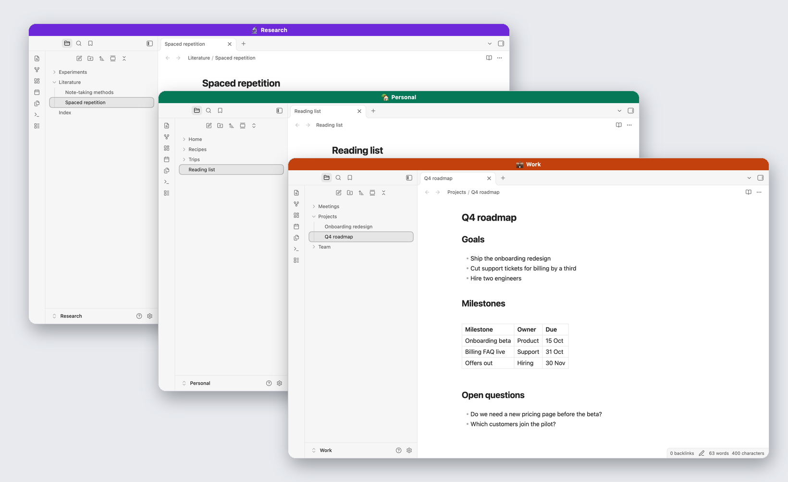
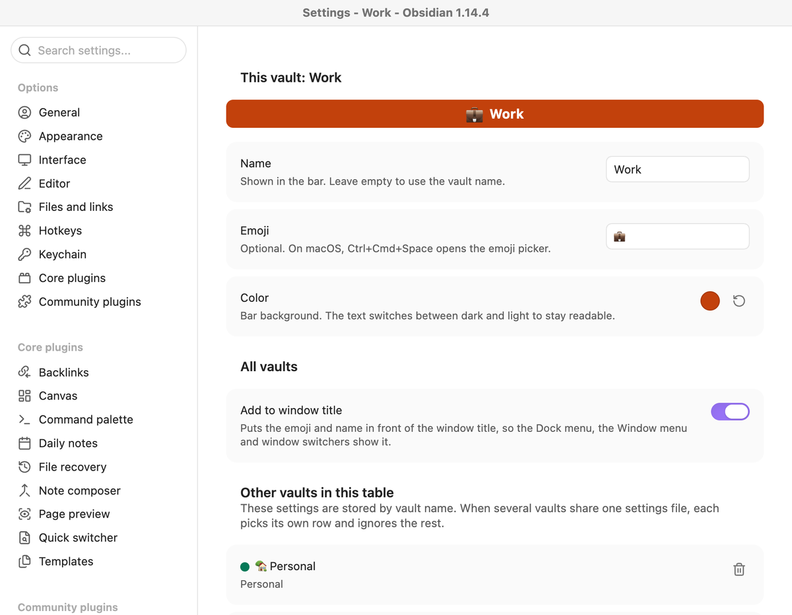

# Vault Flag

Give every Obsidian vault a name, an emoji and a color, and see at a glance which vault a window belongs to.

## Why I built this

I usually have several vaults open at once: my main vault, one per client project, and a few for side projects. Most of them run in full screen. Getting to the right one was a guessing game.

- **Cmd+Tab shows one Obsidian icon,** however many vaults are open, and takes me to whichever window I used last.
- **Mission Control labels every full-screen window "Obsidian".** The thumbnails show a note, not the vault it belongs to.
- **The windows look identical,** because I sync theme and settings across all my vaults on purpose. Even after I landed in a window, I had to look twice to know where I was.

What I wanted was simple: the vault's identity in the same place in every window, big and colorful enough to see in a thumbnail, without giving up my synced settings.

## What it does

- **A colored bar across the top of every window** with the vault's emoji and name. Pop-out windows get it too. The text switches between dark and light to stay readable.
- **The flag in front of the window title.** Anything that lists windows by title, like the Dock menu, the Window menu or a switcher such as AltTab, shows "💼 Work · Q4 roadmap" instead of only the note name. You can turn this off.
- **Useful without any setup.** A vault without settings shows its own name on a color derived from that name, so a fresh install already tells your vaults apart.

## Settings

Open Settings → Vault Flag and set the name, the emoji and the color for the vault you are in. On macOS, Ctrl+Cmd+Space opens the emoji picker.

## Works with synced settings

This was the tricky part for me. I use the Settings Profiles plugin to keep the same theme, plugins and plugin settings in all my vaults, so any per-vault setting got overwritten on the next sync.

Vault Flag stores its settings as one table keyed by vault name. Every vault receives the whole table and picks its own row. When you save, the plugin writes only the current vault's row on top of what is on disk, so two vaults never overwrite each other. The same works with any setup that shares `.obsidian` settings between vaults, and of course without any sync.

**Privacy:** the table contains the names of all vaults that share it. Anyone who gets a copy of a vault folder can read them in `.obsidian/plugins/vault-flag/data.json`. If that matters for a vault you share with others, keep that vault out of the shared settings.

## Install

Until Vault Flag is listed under Community plugins:

1. Download `main.js`, `manifest.json` and `styles.css` from the [latest release](https://github.com/felix-reiners/obsidian-vault-flag/releases/latest).
2. Put them in `<your vault>/.obsidian/plugins/vault-flag/`.
3. Enable Vault Flag under Settings → Community plugins.

You can also install it with [BRAT](https://github.com/TfTHacker/obsidian42-brat) by adding `felix-reiners/obsidian-vault-flag`.

## Compatibility

Desktop only. I tested it with Obsidian 1.14 on macOS, in windowed and full-screen mode, with the default window frame. I have not tested it on Windows or Linux yet. If something looks off there, I'd be glad about an issue with a screenshot.

## License

MIT
